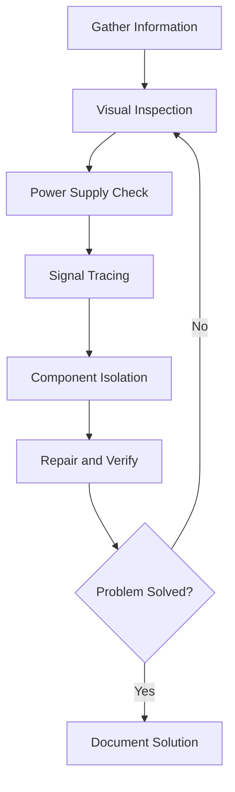

# Electronic Repair Guide

#electronics #repair #documentation #guide

> [!abstract] Quick Start
> This comprehensive guide covers electronic repair from beginner to advanced levels. Start with [[#Getting Started]] if you're new, or jump to specific sections using the links below.

## 🗂️ Table of Contents
- [[#🚀 Getting Started]]
- [[#🔧 Essential Tools]]
- [[#⚡ Basic Electronics Theory]]
- [[#🔍 Component Identification]]
- [[#🔍 Testing and Troubleshooting]]
- [[#⚙️ Repair Techniques]]
- [[#🛠️ Common Problems and Solutions]]
- [[#⚠️ Safety Guidelines]]
- [[#📚 Learning Resources]]

---

## 🚀 Getting Started

> [!tip] Prerequisites
> - Basic understanding of electricity
> - Willingness to learn through hands-on practice
> - Patience for methodical troubleshooting

### 📅 Learning Timeline

| Phase | Duration | Focus |
|-------|----------|--------|
| **Foundation** | Weeks 1-4 | Electronics theory, component identification |
| **Tools & Techniques** | Weeks 5-8 | Soldering, multimeter usage, basic testing |
| **Practice** | Weeks 9-16 | Simple repairs, circuit analysis |
| **Advanced** | Months 5+ | Complex troubleshooting, component-level repair |

---

## 🔧 Essential Tools

### 🎒 Basic Tool Kit
- **[[#Multimeter]]** - For measuring voltage, current, resistance, and continuity
- **[[#Soldering Iron]]** (25-40W) - For component replacement and wire connections
- **[[#Desoldering Tools]]** - Solder wick, desoldering pump, or desoldering station
- **Screwdrivers** - Phillips, flathead, Torx, and security bits
- **Wire Strippers** - For preparing wire connections
- **Needle-nose Pliers** - For handling small components
- **Anti-static Wrist Strap** - [[#ESD Protection]]

> [!note] Tool Investment Strategy
> Start with basic tools and upgrade as you gain experience. Quality tools last longer and provide better results.

### 🔬 Advanced Tools
- **Oscilloscope** - For signal analysis and timing issues
- **Function Generator** - For testing circuits with known signals
- **Hot Air Rework Station** - For SMD component work
- **Magnifying Glass/Microscope** - For detailed inspection
- **Component Tester** - For quick component verification

### 🧪 Consumables Checklist
- [ ] **Solder** (60/40 or 63/37 rosin core)
- [ ] **Flux** - Improves solder flow and quality
- [ ] **Isopropyl Alcohol** (99%) - For cleaning
- [ ] **Replacement Components** - Common resistors, capacitors, diodes
- [ ] **Wire** - Various gauges for jumper repairs

---

## ⚡ Basic Electronics Theory

> [!info] Fundamental Concepts
> Understanding these basics is crucial for effective troubleshooting and repair.

### 🔋 Core Principles
- **Voltage (V)** - Electrical potential difference, measured in volts
- **Current (I)** - Flow of electrical charge, measured in amperes  
- **Resistance (R)** - Opposition to current flow, measured in ohms
- **Power (P)** - Rate of energy consumption, measured in watts

### 📐 Ohm's Law
```
V = I × R
P = V × I
P = I² × R
P = V² / R
```

> [!example] Practical Application
> If you have a 12V supply and a 100Ω resistor:
> - Current: I = V/R = 12V/100Ω = 0.12A (120mA)
> - Power: P = V²/R = 144V²/100Ω = 1.44W

### 🔄 Circuit Types

#### Series Circuit
- Components connected end-to-end
- Same current through all components
- Voltage divides across components
- Total resistance = R₁ + R₂ + R₃...

#### Parallel Circuit  
- Components connected across common points
- Same voltage across all components
- Current divides between branches
- Total resistance = 1/(1/R₁ + 1/R₂ + 1/R₃...)

---

## 🔍 Component Identification

### 🎛️ Passive Components

#### Resistors
| Property | Details |
|----------|---------|
| **Purpose** | Limit current flow |
| **Identification** | Color bands or numerical markings |
| **Common Values** | 1Ω to 10MΩ |
| **Failure Modes** | Open circuit, value drift, burning |

> [!tip] Color Code Memory
> **B**ad **B**oys **R**ace **O**ur **Y**oung **G**irls **B**ut **V**iolet **G**enerally **W**ins
> (Black, Brown, Red, Orange, Yellow, Green, Blue, Violet, Gray, White)

#### Capacitors
| Type | Characteristics | Applications |
|------|----------------|-------------|
| **Ceramic** | Small, stable, non-polarized | Decoupling, filtering |
| **Electrolytic** | High capacity, polarized | Power supply filtering |
| **Tantalum** | Stable, polarized | Low ESR applications |
| **Film** | Precision, non-polarized | Audio, timing circuits |

> [!warning] Polarized Capacitors
> Always observe polarity markings! Reverse connection can cause explosion.

**Common Failure Modes:**
- Short circuit
- Open circuit  
- Leakage current increase
- ESR (Equivalent Series Resistance) increase
- Physical bulging or leaking

#### Inductors
- **Purpose**: Store energy in magnetic field, filter signals
- **Types**: Air core, ferrite core, toroidal
- **Identification**: Color bands or printed values
- **Failure Modes**: Open circuit, short circuit, core saturation

### 🔌 Active Components

#### Diodes
| Type | Forward Voltage | Applications |
|------|----------------|-------------|
| **Silicon** | ~0.7V | General purpose rectification |
| **Schottky** | ~0.3V | Fast switching, low dropout |
| **Zener** | Varies | Voltage regulation |
| **LED** | 1.8-3.3V | Indication, lighting |

> [!example] Testing Diodes
> Use multimeter diode test mode:
> - Forward direction: Should show voltage drop
> - Reverse direction: Should show "OL" (open)

#### Transistors
**Bipolar (BJT):**
- **NPN**: Current flows Collector→Emitter when Base is positive
- **PNP**: Current flows Emitter→Collector when Base is negative

**Field Effect (FET):**
- **N-Channel**: Current flows Drain→Source when Gate is positive  
- **P-Channel**: Current flows Source→Drain when Gate is negative

#### Integrated Circuits (ICs)
- **Logic ICs**: Digital processing, gates, flip-flops
- **Analog ICs**: Amplifiers, regulators, comparators
- **Microprocessors**: Complex digital processing
- **Memory**: Data storage (RAM, ROM, Flash)

---

## 🔍 Testing and Troubleshooting

### 👁️ Visual Inspection Checklist
- [ ] **Obvious damage**: Burned components, bulged capacitors, cracked solder joints
- [ ] **Contamination**: Corrosion, liquid damage, debris
- [ ] **Connections**: Loose wires, broken traces, cold solder joints
- [ ] **Component orientation**: Incorrect polarity, wrong placement

### 🔧 Multimeter Testing

#### Continuity Testing
> [!tip] When to Use
> - Checking fuses, switches, wires
> - Verifying PCB traces
> - Testing cable connections

**Procedure:**
1. Set multimeter to continuity mode (🔊 symbol)
2. Power OFF the device
3. Touch probes to test points
4. Listen for beep (indicates continuity)

#### Voltage Testing
> [!caution] Safety First
> Always verify multimeter is set to correct range and type (AC/DC)

**Common Test Points:**
- Power supply outputs
- IC pin voltages
- Signal levels
- Battery voltages

#### Resistance Testing
> [!important] Power Must Be OFF
> Never test resistance on powered circuits!

**Applications:**
- Component value verification
- Short circuit detection (0Ω)
- Open circuit detection (infinite Ω)
- Insulation testing

### 🔬 Systematic Troubleshooting Process



1. **Gather Information**: Symptoms, history, intermittent issues
2. **Visual Inspection**: Look for obvious problems
3. **Power Supply Check**: Verify all voltage rails
4. **Signal Tracing**: Follow signals from input to output
5. **Component Isolation**: Test suspicious components
6. **Repair and Verify**: Fix problems and test functionality

---

## ⚙️ Repair Techniques

### 🔥 Soldering Best Practices

> [!tip] Temperature Settings
> - **Standard components**: 300-350°C
> - **Heat-sensitive parts**: 250-280°C
> - **Heavy ground planes**: 380-400°C

#### Step-by-Step Process
1. **Clean the iron tip** with damp sponge
2. **Tin the tip** with fresh solder
3. **Heat the joint**, not the solder
4. **Apply solder** to the joint (not the iron)
5. **Remove solder first**, then iron
6. **Allow to cool** without movement

#### Common Soldering Problems
| Problem | Cause | Solution |
|---------|-------|----------|
| **Cold Joint** | Insufficient heat | Increase temperature, reheat |
| **Solder Bridges** | Too much solder | Use solder wick to remove excess |
| **Lifted Pads** | Overheating | Lower temperature, work faster |
| **Rough Joints** | Contamination | Clean with flux, use fresh solder |

### 🔧 Desoldering Techniques

#### Methods
1. **Solder Wick**: Braided copper absorbs molten solder
2. **Solder Pump**: Vacuum removes solder when trigger released
3. **Hot Air**: Melts solder for easy component removal
4. **Desoldering Station**: Professional heated vacuum system

#### Best Practices
- Add fresh flux before desoldering
- Work quickly to minimize heat damage
- Clean pads thoroughly before new component installation
- Use appropriate tip size for the job

### 🛠️ Common Repair Operations

#### Component Replacement
1. **Document** original component orientation (photos help!)
2. **Remove** old component carefully
3. **Clean** pads and apply fresh flux
4. **Install** new component with correct orientation
5. **Verify** connections and test functionality

#### Trace Repair
> [!warning] Delicate Work
> PCB traces are fragile. Work slowly and carefully.

**Procedure:**
1. Clean damaged area with isopropyl alcohol
2. Scrape away solder mask if needed
3. Apply jumper wire or conductive paint
4. Protect repair with conformal coating

#### Connector Repair
- Check for bent pins or damaged contacts
- Clean with contact cleaner
- Replace damaged connectors when possible
- Add strain relief to prevent future damage

---

## 🛠️ Common Problems and Solutions

### 🔌 Power Supply Issues

| Symptom | Possible Causes | Solutions |
|---------|----------------|-----------|
| **No Power** | Blown fuse, bad switch, cord damage | Check fuses, test switch continuity, inspect cord |
| **Wrong Voltage** | Failed regulator, bad capacitor | Test regulators, replace filter caps |
| **Ripple/Noise** | Worn capacitors, poor grounding | Replace electrolytics, improve ground connections |
| **Intermittent** | Thermal issues, cold solder joints | Check for overheating, reflow suspicious joints |

### 📡 Signal Problems

| Symptom | Possible Causes | Solutions |
|---------|----------------|-----------|
| **No Signal** | Bad connections, failed coupling caps | Check input/output, test coupling capacitors |
| **Distorted Signal** | Amplifier failure, power supply issues | Test amplifier components, verify supply voltages |
| **Intermittent** | Poor connections, thermal problems | Check solder joints, look for cracked components |

### 🔥 Component Failures

> [!danger] Safety Warning
> Always check for underlying causes before replacing blown fuses!

#### Fuse Replacement
1. **Find the cause** of fuse failure first
2. **Test for short circuits** before installing new fuse
3. **Use correct rating** - never exceed original specifications
4. **Consider upgrading** to slow-blow if fast-blow fuses fail repeatedly

#### Capacitor Replacement
**Signs of failure:**
- Bulging or leaking electrolytic caps
- High ESR readings
- Reduced capacitance
- Physical damage

**Replacement procedure:**
1. Note polarity markings
2. Use same or higher voltage rating
3. Capacitance can be ±20% of original
4. Consider upgrading to low-ESR types

---

## ⚠️ Safety Guidelines

### ⚡ Electrical Safety

> [!danger] High Voltage Warning
> Some devices store dangerous voltages even when unplugged. Always discharge capacitors safely.

#### Safety Checklist
- [ ] **Disconnect power** before working
- [ ] **Verify power is off** with multimeter
- [ ] **Discharge capacitors** safely
- [ ] **Use proper PPE** (safety glasses, gloves)
- [ ] **Work in well-lit areas**
- [ ] **Keep workspace clean and organized**

### 🛡️ ESD Protection

> [!info] ESD Damage
> Static electricity can destroy sensitive components instantly and invisibly.

#### ESD Prevention
- **Use anti-static wrist straps** when handling CMOS/FET components
- **Work on anti-static mats**
- **Store components** in anti-static bags
- **Avoid synthetic clothing** that generates static
- **Maintain 30-70% humidity** in work area

### 🧪 Chemical Safety

| Chemical | Hazards | Precautions |
|----------|---------|-------------|
| **Flux** | Skin/eye irritation | Wear gloves, use ventilation |
| **Solder** | Lead exposure | Wash hands, avoid inhalation |
| **Isopropyl Alcohol** | Flammable, vapors | Keep away from heat sources |
| **Cleaning Solvents** | Toxic vapors | Use with ventilation |

---

## 📚 Learning Resources

### 🌐 Online Resources

#### YouTube Channels
- **EEVblog** - Professional electronics and test equipment
- **BigClive** - Reverse engineering and safety analysis  
- **ElectroBOOM** - Entertaining electronics education
- **w2aew** - RF and analog circuit design

#### Websites
- **All About Circuits** - Free textbooks and tutorials
- **Electronics Tutorials** - Comprehensive theory coverage
- **CircuitLab** - Online circuit simulation
- **Falstad Circuit Simulator** - Interactive circuit analysis

#### Communities
- **EEVblog Forum** - Professional electronics discussion
- **Reddit r/AskElectronics** - Q&A and troubleshooting help
- **Stack Overflow (Electronics)** - Technical questions
- **Discord Electronics Communities** - Real-time chat help

### 📖 Essential Books

> [!quote] Classic References
> These books are considered essential reading for electronics professionals.

1. **"The Art of Electronics"** - Horowitz & Hill
   - Comprehensive reference for analog and digital circuits
   - Excellent for understanding circuit design principles

2. **"Practical Electronics for Inventors"** - Scherz & Monk
   - Hands-on approach with practical examples
   - Good for beginners to intermediate level

3. **"Electronic Principles"** - Malvino & Bates
   - Solid foundation in electronics theory
   - Widely used in educational settings

### 🎓 Formal Education

#### Local Options
- **Community College** electronics courses
- **Vocational schools** with electronics programs
- **University extension** programs

#### Online Learning
- **Coursera** - University-level courses
- **edX** - MIT and other prestigious institutions
- **Udemy** - Practical, project-based learning
- **Khan Academy** - Free basic electronics

#### Certifications
- **IPC Soldering Certification** - Industry-recognized soldering skills
- **ETA Certification** - Electronics technician credentials
- **CompTIA A+** - Computer hardware fundamentals

### 🛠️ Practice Opportunities

#### Hands-On Learning
- **Repair Cafes** - Community repair events
- **Maker Spaces** - Access to tools and community
- **Electronics Kits** - Structured learning projects
- **Arduino/Raspberry Pi** - Modern electronics platforms

#### Project Ideas
- **Radio restoration** - Classic AM/FM receivers
- **Audio equipment** - Amplifiers, speakers
- **Vintage computers** - Retro computing hardware
- **Test equipment** - Build your own instruments

---

## 🎯 Quick Reference

### 📊 Component Values Quick Chart

| Component | Typical Values | Color Code/Marking |
|-----------|---------------|-------------------|
| **Resistors** | 1Ω - 10MΩ | Color bands |
| **Capacitors** | 1pF - 1000μF | Numerical marking |
| **Inductors** | 1μH - 1H | Color bands/stamped |
| **Diodes** | 0.7V forward | Part number |

### 🔧 Troubleshooting Quick Steps

1. **Power** - Check all supply voltages
2. **Inputs** - Verify signal sources
3. **Outputs** - Test load connections  
4. **Ground** - Ensure good ground connections
5. **Components** - Test suspicious parts

### 📱 Mobile Apps for Electronics
- **ElectroDroid** - Reference data and calculators
- **Resistor Color Code** - Quick resistor value lookup
- **Electronics Toolkit** - Various calculation tools
- **Circuit Solver** - Basic circuit analysis

---

## 📝 Maintenance Log Template

> [!example] Documentation Template
> Keep detailed records of your repairs for future reference.

```
Device: _______________
Date: _________________
Problem: ______________
Tests Performed: ______
Components Replaced: ___
Solution: _____________
Notes: _______________
```

---

> [!success] Conclusion
> Electronic repair is a skill that develops through consistent practice and continuous learning. Start with simple projects, build your tool collection gradually, and don't be afraid to make mistakes - they're valuable learning opportunities.

> [!warning] Final Reminder
> Safety should always be your first priority. When in doubt, consult experienced technicians or refer to service manuals.

---

#electronics #repair #troubleshooting #soldering #components #safety